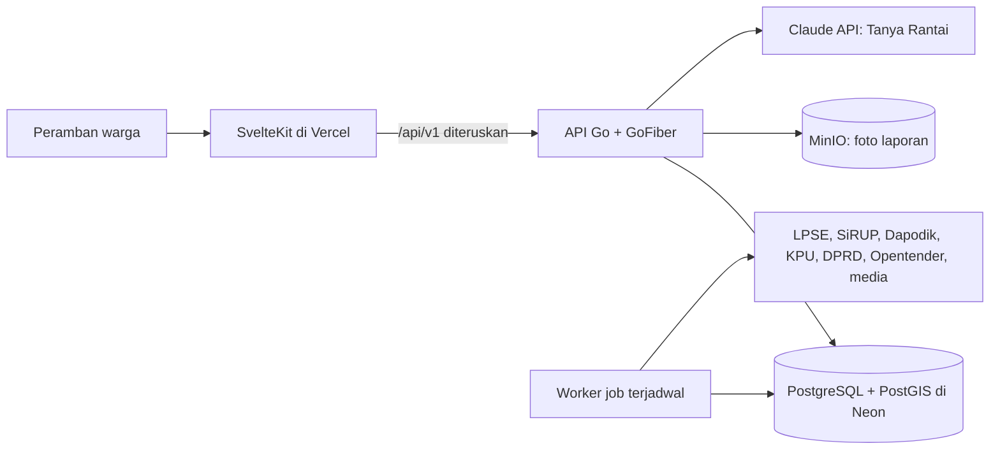

# Rantai

Web transparansi publik untuk DKI Jakarta: apakah kursi sekolah di wilayahku cukup, ke mana uang kotaku mengalir, dan siapa yang bertanggung jawab. Setiap angka bisa ditelusuri ke sumbernya.

Pratinjau: [rantai-civic.vercel.app](https://rantai-civic.vercel.app) (bahasa Indonesia di `/id`, English di `/en`)

## Deskripsi

Warga mengetik kelurahan atau kecamatan, atau memakai lokasinya, lalu membuka halaman kecamatan dengan tiga lensa:

1. **Layanan**: apakah kursi SMP negeri di kecamatanku cukup untuk lulusan SD tahun ini?
2. **Uang**: proyek apa yang dibiayai di sini, berapa nilainya, siapa pelaksananya, dan apakah masih dalam masa pemeliharaan?
3. **Tanggung jawab**: instansi mana yang berwenang, komisi DPRD mana yang mengawasi, dan siapa wakil dapilku?

Rantai terdiri dari inti tetap dan tema yang bisa ditambah lewat konfigurasi. Tema pertama adalah **Pendidikan**. Setiap angka membawa lencana kepastian (resmi, proksi, estimasi, atau simulasi) yang membuka sumber, waktu ambil, dan rumusnya. Pola data yang janggal ditampilkan sebagai "perlu ditanyakan" lengkap dengan pembanding, bukan tuduhan, dan Rantai tidak memberi skor atau peringkat kepada politisi.

Karya cabang Web In Action, MIA 2026 (UPNVJ), tema "Designing Digital Futures, Powering Public Transparency".

## Fitur

| Modul | Fitur |
| --- | --- |
| Wilayah | Pencarian kelurahan dan kecamatan serta "pakai lokasiku"; halaman kecamatan dengan bagian Tema, Arus Anggaran, dan Wakilku; peta kesenjangan kursi, proyek, sekolah, dan laporan warga dengan tabel alternatif; lencana sumber di setiap angka; halaman Tentang Data; Pantau Wilayahku dengan feed dan Web Push |
| Tema Pendidikan | Kesenjangan kursi SMP negeri per kecamatan; daftar sekolah dan daya tampungnya; grafik kesenjangan dibanding belanja sekolah; anggota Komisi E yang menyuarakan isu sekolah; Cek Sekolahku berbasis radius |
| Arus Anggaran | Paket LPSE DKI bertaut ke RUP SiRUP; lokasi paket dari namanya; halaman paket berbentuk rantai dari rencana sampai bukti warga; estimasi masa pemeliharaan; pembanding HPS paket sejenis dan sinyal perlu ditanyakan; profil penyedia dari Opentender; Aspirasi ke Anggaran; Lapor Bukti dengan foto tanpa EXIF dan verifikasi saksi |
| Wakilku | Dapil dan anggota DPRD DKI 2024 sampai 2029; profil dengan komisi, alat kelengkapan, dan tautan LHKPN; jejak kegiatan dari rilis resmi DPRD dan media terverifikasi dengan ringkasan netral; isu yang disuarakan; sikap fraksi; aspirasi reses per bidang |
| Aksi | Tanya Rantai dengan rujukan bernomor yang membuka sumber; Paket Aspirasi dalam teks dan PDF ke kanal yang tepat; jalur aspirasi terdekat; Data yang Belum Dibuka dengan templat permohonan PPID |
| Akun | Masuk tanpa kata sandi dengan kode OTP email; Panel Instansi dan anggota DPRD untuk hak jawab yang tampil apa adanya; panel moderasi laporan dan umpan |

## Arsitektur



- **Frontend** merender halaman di server (SSR) dan meneruskan `/api/v1/*` ke API, sehingga cookie sesi tetap satu situs.
- **API** mengikuti clean architecture: `domain` (aturan bisnis murni), `usecase`, `repository`, `delivery/http`. Aturan yang sering berubah (kategori paket, ambang sinyal, kewenangan, tema) disimpan di `backend/config/*.yaml` dan tabel `tema`.
- **Worker** menjalankan satu job per sumber data dengan batas 1 permintaan per detik per domain, cek robots.txt, dan cache respons mentah. Setiap nilai menyimpan provenance (sumber, waktu ambil, label kepastian).
- **Tanya Rantai** memakai tool use: model hanya boleh memanggil fungsi kueri tetap, lalu validator menolak jawaban yang memuat angka tanpa sumber atau kosakata terlarang.

## Tech stack

| Lapis | Teknologi |
| --- | --- |
| Backend API dan worker | Go, GoFiber v3, clean architecture |
| Database | PostgreSQL 16 + PostGIS 3 (Neon) |
| Penyimpanan objek | MinIO (kompatibel S3) |
| Frontend | SvelteKit 2, Svelte 5, TypeScript, TailwindCSS, Lucide |
| Peta | MapLibre GL JS |
| Tanya Rantai | Claude API dengan tool use |
| Pengujian | go test, Vitest, Playwright, axe |
| Orkestrasi | Docker Compose, Caddy, Vercel |

## Cara menjalankan

Prasyarat: Docker dengan Docker Compose, Go 1.26 ke atas, Node 22 ke atas, GNU Make.

```bash
cp .env.example .env
make up
make migrate
make impor-wilayah
make impor-tema
make impor-kpu-dprd
make impor-sekolah
make impor-daya-tampung
make hitung-calon-lulusan
make hitung-indikator
make impor-lpse
make impor-sirup
make turunan
```

Lalu jalankan API dan frontend di dua terminal:

```bash
cd backend && go run ./cmd/api
cd frontend && npm install && npm run dev
```

Buka `http://localhost:5173`. `make impor-sekolah` mengambil sekitar 4.000 sekolah dengan jeda 1 detik per permintaan, sehingga butuh beberapa jam. Setiap respons disimpan di `data/raw/dapodik/<tanggal>/`, jadi job yang terputus dapat dijalankan ulang pada hari yang sama tanpa mengulang permintaan.

### Mode demo

`make snapshot-demo` menyimpan seluruh data ke `data/snapshot/rantai.sql.gz` di mesin yang datanya sudah lengkap. Di mesin lain, `make up`, `make migrate`, lalu `make seed-demo` memuat snapshot itu dan skenario `data/snapshot/skenario_demo.yaml`: satu paket simulasi, dua laporan simulasi, dan akun contoh warga, petugas instansi, anggota, serta moderator. Semua data simulasi berlabel "Data simulasi" dan tidak tertaut ke penyedia, instansi, atau anggota sungguhan.

Dengan `RANTAI_MODE=demo` di `.env`, worker menolak job yang mengambil data dari internet, Tanya Rantai menjawab pertanyaan demo dari `data/snapshot/tanya_demo.json` (`make tanya-demo`), dan tanpa `SMTP_HOST` kode masuk ditulis ke log API.

### Basis data

Basis data utama (lokal dan produksi) adalah PostgreSQL di Neon dengan ekstensi PostGIS. Isi `DATABASE_URL` dengan URL pooler Neon dan `DATABASE_URL_MIGRASI` dengan URL endpoint langsung (tanpa `-pooler`), karena migrasi memakai advisory lock tingkat sesi. Tambahkan `&pool_max_conn_idle_time=30s&pool_max_conn_lifetime=5m&pool_health_check_period=15s` di akhir `DATABASE_URL` agar koneksi yang menganggur selama job mengambil data tidak diputus Neon di tengah jalan. Tanpa kedua variabel itu, semua perintah memakai PostgreSQL dari `make up`.

## Pengujian

```bash
make lint   # golangci-lint, pemeriksa tanpa komentar, prettier, eslint, svelte-check
make test   # go test ./... dan vitest
make e2e    # Playwright: audit aksesibilitas axe di 15 halaman
RANTAI_MODE=demo make e2e   # ditambah delapan langkah Alur Demo di 390 px dan 1440 px
```

Tes integrasi selalu memakai basis data lokal terpisah `rantai_uji` agar tidak menyentuh data utama. Siapkan sekali dengan `make up && make siapkan-uji`.

## Deploy

API, worker, dan MinIO berjalan di server dengan `docker-compose.prod.yml`; frontend di Vercel.

```bash
cp .env.example .env
docker compose -f docker-compose.prod.yml --profile alat run --rm migrate up
docker compose -f docker-compose.prod.yml --profile caddy up -d --build
docker compose -f docker-compose.prod.yml run --rm --entrypoint worker api <job>
```

Profile `caddy` menyalakan Caddy milik Rantai dengan TLS otomatis untuk `API_DOMAIN` (misalnya `rantai.130-162-198-219.sslip.io`). Bila server sudah punya reverse proxy bersama, lewati profile itu dan tambahkan `-f deploy/compose.proxy-bersama.yml` agar API bergabung ke jaringan proxy (`JARINGAN_PROXY`, bawaan `deploy_default`) dengan alias `rantai-api`. Layanan `cadangan` menyimpan `pg_dump` harian dari Neon ke `cadangan/` selama tujuh hari.

Isi `.env` server dengan URL Neon, `AUTH_RAHASIA`, `PROXY_RAHASIA` acak, kredensial MinIO, dan `CORS_ORIGIN=https://rantai-civic.vercel.app`. Tanpa `SMTP_HOST`, masuk dengan OTP hanya aktif bila `RANTAI_MODE=demo`.

Di Vercel, root directory adalah `frontend`, dengan env berikut:

| Env | Nilai |
| --- | --- |
| `PUBLIC_API_URL` | `https://rantai-civic.vercel.app/api/v1` |
| `API_HULU` | `https://<API_DOMAIN>` |
| `PROXY_RAHASIA` | sama dengan server |
| `PUBLIC_PETA_DASAR_URL` | `https://tiles.openfreemap.org/planet` |

API memakai IP pengunjung dari header `X-Klien-Asli` untuk batas laju hanya bila header `X-Rantai-Proxy` cocok dengan `PROXY_RAHASIA`.

## Progres pengerjaan

- [x] Fondasi repo, lingkungan lokal, lint dan CI
- [x] Server API, skema wilayah, provenance, pengaman HTTP
- [x] Kerangka tema dan data Tema Pendidikan
- [x] Arus Anggaran: LPSE, SiRUP, lokasi paket, pemeliharaan, sinyal, penyedia
- [x] Wakilku: dapil, anggota, komisi, umpan rilis resmi dan media, ringkasan netral
- [x] Mode demo dan skenario data simulasi
- [x] Frontend inti: beranda, halaman kecamatan, detail Pendidikan, peta, paket, Wakilku, Tentang Data
- [x] Aksi: Tanya Rantai, Paket Aspirasi, Data yang Belum Dibuka
- [x] Akun OTP, Panel Instansi, dan hak jawab
- [x] Fitur P1: isu yang disuarakan, sikap fraksi, aspirasi reses, Lapor Bukti, moderasi, profil penyedia, Cek Sekolahku, Pantau dan Web Push
- [x] Redesain antarmuka, tes alur demo, aksesibilitas WCAG 2.1 AA, performa, deploy produksi
- [ ] Snapshot luring final dari data lengkap untuk demo tanpa internet
- [x] Cadangan P2: tren antartahun, unduh CSV paket, kartu ringkasan untuk dibagikan, bahasa Inggris
- [ ] Cadangan P2: pengalih tema, ringkasan mingguan via email

Rincian setiap tugas ada di `docs/PLAN.md`.

## Sumber data

Batas wilayah: [cahyadsn/wilayah_boundaries](https://github.com/cahyadsn/wilayah_boundaries) (MIT), sesuai Kepmendagri No 300.2.2-2430 Tahun 2025. Sekolah dari Dapodik, daya tampung dari Kepkadis Pendidikan DKI 258/2026, paket dari LPSE DKI dan SiRUP, anggota dan dapil dari KPU dan situs DPRD DKI, riwayat penyedia dari Opentender (ODbL). Rincian verifikasi tiap sumber ada di `docs/data-sources.md` dan halaman Tentang Data.

## Pengambilan data

Pengambil data Rantai memakai User-Agent `RantaiBot/1.0 (+https://github.com/benditandayusaputra/rantai)`, mematuhi robots.txt, dan membatasi diri 1 permintaan per detik per domain. Pertanyaan atau keberatan dapat disampaikan lewat issue di repositori ini.
